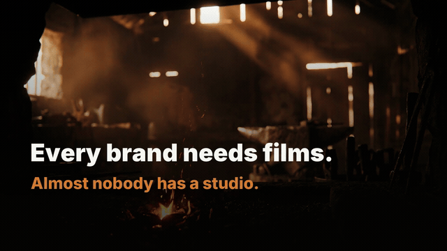
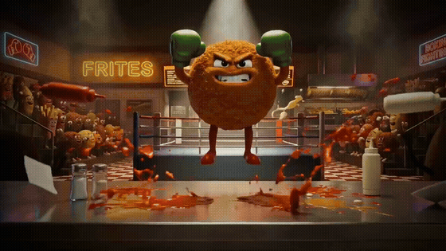

# 🎬 Video Studio — a film studio you drive from chat

> **Turn one idea into a finished, on-brand film — in a few hours, from a chat prompt.**
> A [Claude Code](https://claude.com/claude-code) skill that runs the whole pipeline for you: brand & storyboard intake → capture or generate → edit, grade & localise → deliver. No timeline app. No agency. No shoot day.

<p align="center">
  <a href="LICENSE"></a>
  
  
  
</p>

<p align="center">
  <a href="https://theuws.com/video-studio-skill/"></a>
  <br><em>▶️ <a href="https://theuws.com/video-studio-skill/">Watch the full walkthrough &amp; two example films</a> — the studio explaining itself, and a 90-second case study, both made by this skill.</em>
</p>

<p align="center">
  
  <br><em>A 90-second case study, made end-to-end by the skill — including a full AI-generated trailer (keyframe → image-to-video → montage). <a href="https://theuws.com/video-studio-skill/">See it →</a></em>
</p>

---

## What is this?

Video Studio is a **Claude Code skill**: a `SKILL.md` + reference playbooks + scripts that teach Claude to produce and edit video end‑to‑end. You describe the film you want in plain language; the skill orchestrates the entire pipeline and only stops for **two sign‑offs** (the storyboard, and final approval).

It does two things, and combines them:

- **🎞️ Edit existing footage** — inventory clips (local files or URLs), auto‑select the right shots *by subject* (it reads the frames, not just filenames), then trim, grade and cut to a polished film.
- **🤖 Full‑AI** — keyframe‑first generation: build a consistent start‑frame per shot, animate it with image‑to‑video, letter it, score it, and cut it — never blind text‑to‑video.

…held to one **premium quality bar** the whole way. This isn't a meme‑clip generator; it's built to produce work a brand would pay for.

## Why you'll want it

- **From chat.** No editor, no render farm, no manual export. Prompt → film.
- **On‑brand by default.** It adopts your existing style guide (or creates one), builds a reusable **leader + outro** bracket, and holds the lines you set on every film.
- **A real quality bar.** Crafted transitions (no hard‑cut‑by‑default), heavy readable titles with backing, one consistent grade + grain, a hook in the first 1.5s, audio levelled & ducked. It refuses to ship "technically works."
- **Honest & scriptable.** Proven tools glued into one pipeline — `ffmpeg`, `ImageMagick`, `nano-banana`, `fal.ai`. No black boxes. It even improves its own playbook after every job.
- **Self‑checking.** A tooling **preflight** runs before every job and *stops and asks* rather than silently degrading. And a one‑time **doctor** tells you if your machine is ready.

## ⚡ Quickstart

**1. Install it** — as a plugin (recommended) or a plain skill.

In Claude Code:

```
/plugin marketplace add RichardTheuws/video-studio
/plugin install video-studio@theuws-video
```

Or manually, as a user‑level skill:

```bash
git clone https://github.com/RichardTheuws/video-studio.git
bash video-studio/install.sh    # copies the skill into ~/.claude/skills/video-studio/
```

**2. Check your machine is ready:**

```bash
bash ~/.claude/skills/video-studio/scripts/doctor.sh
```

The doctor reports exactly what you have, what's missing, and which mode you can run today (footage / AI / full) — with copy‑paste install commands for anything absent.

**3. Add your keys** (only what your mode needs) to `~/.config/video-studio/.env`:

```bash
FAL_AI_KEY=...            # image-to-video + AI stills (full-AI mode)
GEMINI_API_KEY=...        # nano-banana keyframes (full-AI mode)
ELEVENLABS_API_KEY=...    # optional: voices / SFX
```

**4. Just ask, in chat:**

> *"Make a 60‑second launch film for our new feature. Adopt our brand from `brand/style.md`. Vertical cutdown too."*

Claude loads the skill, runs the preflight, walks the intake gate, shows you a storyboard to approve, then produces the film. That's it.

> **New to Claude Code?** It's Anthropic's agentic CLI — install it, `cd` into any project, and the skill activates automatically on any video task. See [claude.com/claude-code](https://claude.com/claude-code).

## 🩺 Requirements

The **doctor** (`skills/video-studio/scripts/doctor.sh`) checks all of this for you. In short:

| | Tool | For | Install |
|---|------|-----|---------|
| **Core** | `ffmpeg` · `jq` · `curl` | montage, transcode, grading, audio | `brew install ffmpeg jq` |
| **Full‑AI** | `nano-banana` (Bun + Gemini) | consistent keyframes / stills | see `reference/tooling.md` |
| | `FAL_AI_KEY` | image‑to‑video (Kling v3) | [fal.ai](https://fal.ai) |
| **Titles** | `node` ≥ 22 (HyperFrames via `npx`, pinned) | the title layer: one composition for 9:16 + 16:9 | `brew install node` |
| | `ImageMagick` + `pango` | text *in* the world (perspective on a surface) + fallback titles | `brew install imagemagick pango` |
| **Footage** | `yt-dlp` | *only* to pull clips from URLs | `brew install yt-dlp` |

Primary platform: **macOS**. Most of it is portable to Linux (swap `brew` for your package manager).

## How it works

```
  preflight ─► INTAKE (gate) ─► STORYBOARD (your sign-off) ─► capture / generate
                                                                     │
        deliver + docs ◄─ localise ◄─ edit, grade & score ◄─────────┘
```

The **intake gate** is where most of the time is saved: before a single frame is produced, the studio settles the brief and the brand — does a style guide exist to adopt, or must one be created? Is there a leader/outro? Does this need a storyboard? Which shots need generated keyframes? Getting this wrong is the most expensive mistake in any pipeline, so it's an explicit, non‑negotiable step.

Deep‑dive playbooks live in [`reference/`](skills/video-studio/reference/):

- [`tooling.md`](skills/video-studio/reference/tooling.md) — every tool, how to check it, how to install it
- [`brand-intake.md`](skills/video-studio/reference/brand-intake.md) — the intake gate: brand adopt/create, leader/outro, storyboard, keyframe plan
- [`commercial-craft.md`](skills/video-studio/reference/commercial-craft.md) — **the premium bar**: transitions, readable titles, grade, pacing, QA checklist
- [`models.md`](skills/video-studio/reference/models.md) — model registry (image + image‑to‑video + audio) with costs & params
- [`consistency.md`](skills/video-studio/reference/consistency.md) — consistent characters across shots (anchor reference, keyframe‑first, text‑less + lettering)
- [`montage-ffmpeg.md`](skills/video-studio/reference/montage-ffmpeg.md) — montage recipes + hard‑won ffmpeg gotchas
- [`existing-footage.md`](skills/video-studio/reference/existing-footage.md) — probe, download, subject auto‑select, trim/concat/grade
- [`landscape-from-vertical.md`](skills/video-studio/reference/landscape-from-vertical.md) — reframe 9:16 ↔ 16:9 without stretching
- [`titles-hyperframes.md`](skills/video-studio/reference/titles-hyperframes.md) — **the title layer**: one HTML composition for 9:16 + 16:9, words that build, rendered as one transparent overlay ([`templates/titles/`](skills/video-studio/templates/titles/))
- [`directing.md`](skills/video-studio/reference/directing.md) — direction & rhythm: shot grammar fixed before generation, cut lengths, measurable QA (+ `scripts/pick-window.sh`)
- [`title-sequence.md`](skills/video-studio/reference/title-sequence.md) — a brand leader / title sequence: text in the world, one visible cut
- [`storyboard-keyframes.md`](skills/video-studio/reference/storyboard-keyframes.md) — a visual keyframe board as the cheap gate before image‑to‑video (+ `scripts/storyboard.sh`)
- [`vertical-916.md`](skills/video-studio/reference/vertical-916.md) — a real 9:16 master, never a squashed or blurred 16:9
- [`series-production.md`](skills/video-studio/reference/series-production.md) — one film → a series or campaign, from one proven template
- [`scroll-video.md`](skills/video-studio/reference/scroll-video.md) — a film the visitor plays by scrolling
- [`print-on-product.md`](skills/video-studio/reference/print-on-product.md) — a print on a product that reads as real, measured not guessed
- [`lessons.md`](skills/video-studio/reference/lessons.md) — a running log of production lessons

## The quality bar (the part most tools skip)

Four defaults it **never** ships with:

1. **No hard cuts by default** — premium leans on crafted transitions (cross‑dissolves, dip‑to‑white, speed‑ramps, J/L‑cuts). A hard cut is a deliberate choice on the beat.
2. **No thin, unreadable titles** — text is always heavy (700–900), large, and on backing (scrim / plate / bar). One type system.
3. **No flat, jumping grade** — one consistent, rich grade across every shot, plus grain.
4. **Never "technically works"** — a moving medium is judged on a dense frame‑strip and real playback, never on stray thumbnails, and one cut is validated before fanning out to languages or formats.

## ⭐ Star it

If this saves you a shoot day — or just makes you smile — **give it a star**. It's the fastest way to help other builders find it, and it's the only thanks the repo asks for.

## Contributing

Issues and PRs welcome — new montage recipes, model updates, platform ports, better prompts. The skill is designed to grow: every lesson goes into `reference/lessons.md` and the `CHANGELOG`.

## License

[MIT](LICENSE) — use it, fork it, ship films with it.

---

<sub>Built by <a href="https://theuws.com">Theuws Consulting</a>. Born from a game trailer that came out so good it became a studio — <a href="https://theuws.com/video-studio-skill/">the story</a>.</sub>
